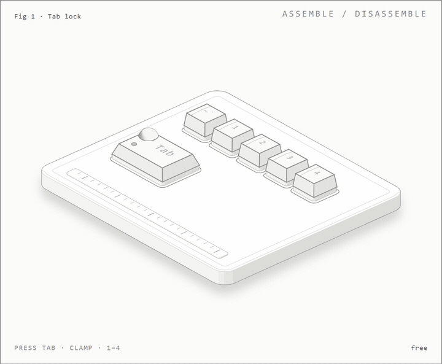

# TT-copy-paste Lite v.2

> A minimalist AutoHotkey script for Copy/Paste. Remaps `Tab` + `1/2/4` to `Ctrl+C/V/A`. Designed for zero learning curve and one-handed operation.

## 👀 A concept picture (not part of the script)

A concept animation. It is not a recording of the script.

The script itself is simple: you hold `Tab` with your own finger and tap a number. `Tab` + `1` is Copy. You don't need a clamp, extra buttons or any hardware, just the `.ahk` file.

The picture above is a different thing. While I was thinking about this idea I sketched a concept keyboard where a small mechanical clamp holds `Tab` down, so the top row stays switched to Copy, Paste, Cut and Select All. Lite has no Cut (`Tab` + `3` is off on purpose), so the drawing shows a bit more than this script does. I made it because a table of hotkeys is dull to read, and it's easier to picture the idea when you can see the keys move.

It's only a prototype drawing. Nothing like it ships with this repo, and there is no device you can buy or touch. If you want to build real key movements on the same idea, go for it, but that is a separate project.

## ⚡ What is the "Lite" Version?
This is a stripped-down version of the full [TanTadiTaz script](https://github.com/alexanderM23/autohotkey-copy-paste-tantadtaz).
While the original script turns the entire keyboard into a navigation grid, **Lite v.2** focuses strictly on the 5 most used commands.

**Why use Lite?**
*   **Zero Learning Curve:** You only need to remember 3 numbers.
*   **Safety:** No complex layers or modes that might interfere with other software.
*   **Focus:** Perfect if you just want to fix the "awkward Ctrl+C stretch" without changing your entire workflow.

## 🔦 The "Why"
Originally built because my keyboard's bottom row (`Ctrl`, `Alt`, `Shift`) stopped working after a liquid spill. I needed a way to copy/paste using only the top row. It turned out that `Tab` + Numbers is significantly faster and easier to hit in the dark than standard shortcuts.

---

## ⌨️ Key Mappings (The "Ta-n, Ta-di, Ta-La" System)

Hold `Tab` to activate. Release to use normal Tab.

### 1. Clipboard (Top Row Numbers)
| Shortcut | Action | Mnemonic |
| :--- | :--- | :--- |
| `Tab` + `1` | **Copy** (`Ctrl+C`) | Ta-**n** (One) |
| `Tab` + `2` | **Paste** (`Ctrl+V`) | Ta-**di** (Double) |
| `Tab` + `4` | **Select All** (`Ctrl+A`) | Ta-**La** (All) |

*(Note: `Tab+3` is disabled in Lite to prevent accidental Cuts)*

### 2. Utilities (WASD Row)
| Shortcut | Action | Use Case |
| :--- | :--- | :--- |
| `Tab` + `S` | **Enter** | Form submission |
| `Tab` + `D` | **Enter** | Alternative (Redundant but convenient) |

---

## 🛠 Installation

1. Install [AutoHotkey](https://www.autohotkey.com/).
2. Download `TT-Lite-v2.ahk` from this repo.
3. Run the script.

### Controls & Safety
*   **ScrollLock**: Toggle Script ON/OFF (Suspend). Use this if you need `Alt+Tab` or standard `Tab` behavior for gaming.
*   **Emergency Exit**: `Ctrl+Alt+Shift+Win+F12` (Terminates script instantly).

## ⚠️ Limitations
*   **Alt+Tab:** Standard Alt+Tab behavior is interrupted while the script is active (since `Tab` is now a modifier). Use `ScrollLock` to switch windows.
*   **Input Lag:** Tiny delay on the `Tab` key (AHK waits to see if you press a number).

## License
MIT. Simple code for simple problems.

---
*Created by Aleksandrs M. Orrin. Minimalist productivity.*
